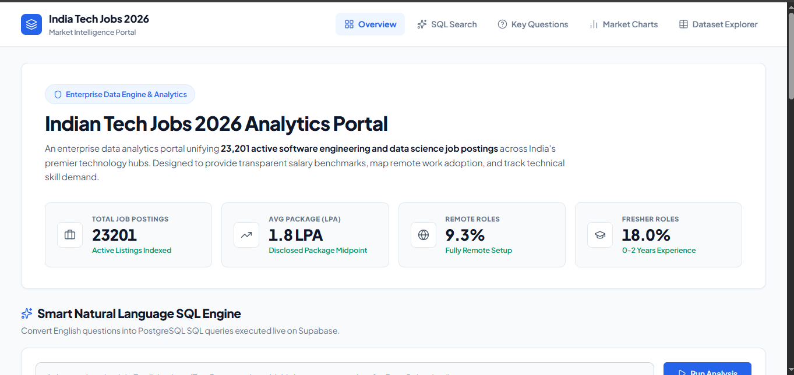
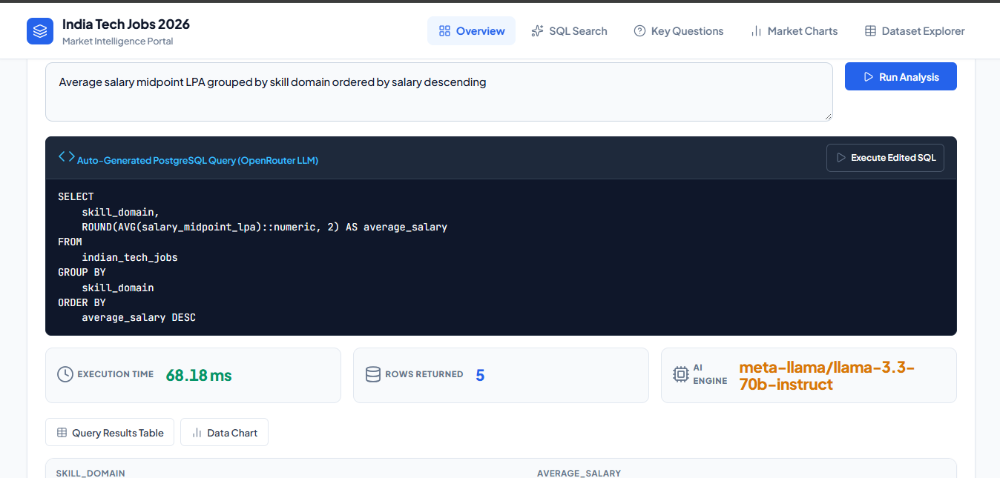
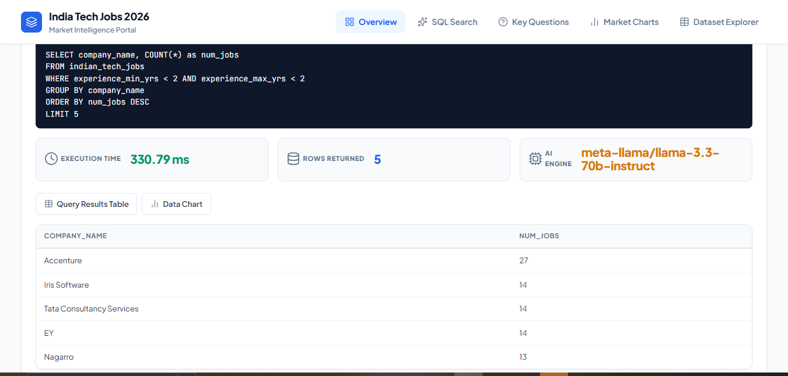
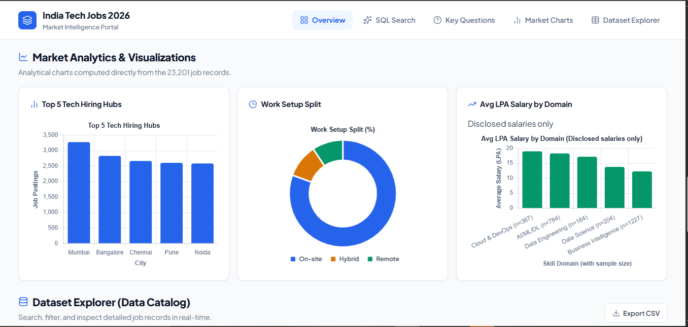

# India Tech Jobs 2026: Natural Language to SQL Analytics Portal

<div align="center">


A Django web application that converts plain-English questions into PostgreSQL queries using LLMs via OpenRouter, featuring a hardened read-only SQL validation layer, automatic Chart.js visualizations, and an interactive dataset explorer built over 23,201 Indian tech job records.

[Features](#features) · [Screenshots](#screenshots) · [Architecture](#architecture) · [Quick Start](#quick-start) · [Dataset](#dataset) · [Data Notes](#data-notes) · [Key Insights](#key-insights) · [Why This Project Matters](#why-this-project-matters) · [How It Works & Safety](#how-it-works--safety) · [Evaluation](#evaluation) · [Limitations](#limitations) · [Author](#author)

</div>

---

## Features

- **Natural Language to SQL**: Translates everyday business questions into valid PostgreSQL queries.
- **Hardened SQL Safety Layer**: Multi-step validation restricting queries to single-statement, read-only SELECT/WITH queries against an allow-listed table.
- **Interactive Visualizations**: Automatic Chart.js rendering for aggregations, plus pre-computed KPI tiles and distribution charts.
- **Dataset Explorer**: Paginated exploration table with multi-column filtering by city, domain, work mode, and minimum salary.
- **Pre-Built Question Library**: Curated queries covering salary distribution, remote roles, fresher entry points, and required skills.
- **Multi-LLM Fallback**: Primary translation via Llama 3.3 70B with automatic fallback to Claude 3.5 Sonnet, DeepSeek R1, and GPT-4o Mini.
- **Raw SQL Protection**: Dedicated `/api/run-sql/` endpoint protected by `ENABLE_RAW_SQL` environment toggle.

---

## Screenshots


*Analytics Portal Interface: Overview KPIs, Quick Query Prompts, and Natural Language SQL Engine*



*Live Query Analysis: Natural Language Prompt, Generated PostgreSQL Query, Model Attribution, and Result Statistics*



---

## Architecture

```
Browser (Frontend)
  HTML5 + CSS + Chart.js + Lucide Icons
        |
        | HTTP / REST (JSON)
        v
Django Application Server
  nl2sql/views.py  -->  nl2sql/services.py
  - /api/nl2sql/         - validate_sql() [strict allowlist, comment strip, LIMIT 500]
  - /api/run-sql/        - execute_sql_query() [READ ONLY transaction, 5s timeout]
  - /api/dataset-browse/
        |                           |
        v                           v
  OpenRouter API             Supabase PostgreSQL DB
  (LLM Translation)          Table: indian_tech_jobs
  Llama 3.3 / Claude /       23,201 rows x 26 columns
  DeepSeek / GPT-4o
```

---

## Quick Start

### Prerequisites

- Python 3.10+
- A [Supabase](https://supabase.com) PostgreSQL database
- An [OpenRouter](https://openrouter.ai) API key

### 1. Clone the repository

```bash
git clone https://github.com/irfan564/SQL-NLP.git
cd SQL-NLP
```

### 2. Set up virtual environment & install dependencies

```bash
python -m venv .venv

# Windows
.venv\Scripts\activate
# Linux/macOS
source .venv/bin/activate

pip install -r requirements.txt
```

### 3. Configure environment variables

Copy `.env.example` to `.env` and fill in your credentials:

```bash
cp .env.example .env
```

Edit `.env`:

```env
SECRET_KEY=your-strong-django-secret-key
DEBUG=True
SUPABASE_DB_URL=postgresql://postgres.<project-ref>:<password>@aws-0-<region>.pooler.supabase.com:5432/postgres
OPENROUTER_API_KEY=sk-or-v1-your-openrouter-api-key
ENABLE_RAW_SQL=False
```

### 4. Database Setup & Seeding

Run Django migrations and upload the dataset to your Supabase PostgreSQL database:

```bash
python manage.py migrate
python seed_supabase.py
```

### 5. Run the application

```bash
python manage.py runserver
```

Open [http://127.0.0.1:8000](http://127.0.0.1:8000) in your browser.

---

## Dataset

The portal analyzes 23,201 Indian tech job records across 26 structured fields stored in table `indian_tech_jobs`.

- **Source**: Kaggle dataset:India Tech jobs 2026

- **Key Columns**:
  - `job_title`: Position title (e.g. Data Scientist, AI/ML Engineer, Full Stack Developer).
  - `company_name`: Hiring company name.
  - `primary_city`: Major Indian tech hub (Bangalore, Hyderabad, Pune, Mumbai, Gurgaon, Noida, Chennai).
  - `salary_midpoint_lpa`: Midpoint annual package in Lakhs Per Annum (LPA).
  - `work_mode`: On-site, Hybrid, or Remote.
  - `skill_domain`: AI/ML/DL, Data Science, Software Engineering, Cloud & DevOps, Business Intelligence.
  - `skills_required`: Comma-separated list of technical skills and tools.
  - `is_fresher_friendly`: Boolean flag indicating 0–2 years experience entry level.
  - `experience_min_yrs` / `experience_max_yrs`: Experience range in years.

Original scraped columns include `job_id`, `job_title`, `company_name`, `company_rating`, `location`, `scraped_city`, `role_category`, `experience_raw`, `salary_raw`, `skills_required`, `job_description`, `posted_date_raw`, `job_url`, `data_source`, and `scraped_at`; while derived analytical attributes created during ingestion include `primary_city`, `skill_domain`, `salary_midpoint_lpa`, `salary_min_lpa`, `salary_max_lpa`, `salary_disclosed`, `salary_tier`, `experience_min_yrs`, `experience_max_yrs`, `experience_tier`, `is_senior`, `is_fresher_friendly`, `salary_negotiable`, `skills_count`, `days_since_posted`, `work_mode`, and `company_size_bucket`.

> **Note:** The raw CSV file (`indian_tech_jobs_2026.csv`) is excluded from git via `.gitignore`. The dataset is populated into the Supabase database using `seed_supabase.py`.

---

## Data Notes

- **Undisclosed Salaries**: 88.1% of job postings (20,435 out of 23,201 records) do not disclose compensation (`salary_midpoint_lpa = 0` or NULL). Consequently, all salary statistics (averages, distributions, domain benchmarks) must explicitly exclude zero/NULL values (`WHERE salary_midpoint_lpa > 0`). Including undisclosed salaries as zeros artificially depresses the overall average to ~1.8 LPA, whereas the true average of disclosed postings is **15.3 LPA**.
- **Masked Company Names**: 579 listings feature generic or masked company names (matching patterns such as '%MNC%', '%Fortune 500%', '%confidential%', '%top rated%', or '%leading%', for example 'Fortune 500 IT Services Company').
- **City Name Normalization**: `primary_city` contains 198 distinct values, including 'Remote' and sub-locality variants (for example Pune(Baner)), so city totals are understated. The dataset under-represents some hubs (Hyderabad has 538 listings), so findings describe this dataset, not the whole market.
- **"0-0 Yrs" Experience Rows**: 1,161 listings (5.0%) specify "0-0 Yrs" experience (`experience_min_yrs = 0` and `experience_max_yrs = 0`), representing entry-level/internship roles or postings where experience requirements were omitted.
- **"Not Available" Skills**: 547 listings (2.4%) contain "Not Available" or empty strings in `skills_required` where granular technology tags were not populated by the recruiter.


---

## Key Insights

- **Salary disclosure:** only 11.9% of listings (2,766 of 23,201) state a salary; the average among them is 15.3 LPA. Counting undisclosed salaries as zero would show about 1.8 LPA.
- **Pay by domain (disclosed salaries only):** Cloud & DevOps 19.0 LPA, AI/ML/DL 18.3, Data Engineering 17.2, Data Science 13.8, Business Intelligence 12.3. The top-to-bottom gap is 6.7 LPA. Sample sizes range from 184 (Data Engineering) to 1,227 (Business Intelligence), so rankings are indicative.
- **Work mode:** 80.6% on-site, 10.1% hybrid, 9.3% remote.
- **Hiring hubs:** Mumbai (3,276), Bangalore (2,830), Chennai (2,666), Pune (2,606) and Noida (2,585) account for about 60% of listings. City names are not fully normalized (198 distinct values).
- **Skills:** Python (2,744 listings) and SQL (2,306) lead the explicit technical skills, followed by machine learning (1,929) and artificial intelligence (1,835).
- **Analyst roles:** about 20% of data and business analyst postings in the 11 largest locations are fresher-friendly (742 of 3,694). Bangalore (774), Pune (597) and Mumbai (576) have the most openings. Average disclosed pay is highest in Hyderabad (16.4 LPA) and Chennai (15.5) and lowest in Bangalore (11.4).

---

## Why this project matters

The AI-generated SQL first averaged all salaries, including undisclosed ones stored as 0 or NULL, and reported about 1.8 LPA. I noticed it did not match my chart, traced the cause, and fixed the prompt and queries. The average for disclosed salaries is 15.3 LPA.

---

## How It Works & Safety

### 7-Step NL2SQL Execution Pipeline

1. **User Prompt**: The user inputs a question in natural language (e.g., *"Show top 5 companies hiring remote Data Scientists"*).
2. **Schema & Rule Injection**: The system combines the user question with full 26-column schema metadata and PostgreSQL instructions in `nl2sql/services.py`.
3. **LLM Generation via OpenRouter**: Queries the OpenRouter API using model fallback priority (`meta-llama/llama-3.3-70b-instruct` $\rightarrow$ `anthropic/claude-3.5-sonnet` $\rightarrow$ `deepseek/deepseek-r1` $\rightarrow$ `openai/gpt-4o-mini`).
4. **SQL Extraction**: Extracts the clean SQL query from markdown code blocks.
5. **Safety Validation**: Validates the query against security rules before touching the database.
6. **Isolated Read-Only Execution**: Runs inside a transactional boundary with database-level read-only enforcement and execution timeout.
7. **Result Delivery & Auto-Charting**: Formats results as JSON, and automatically generates Chart.js bar or doughnut charts if the query returns categorical and numerical columns.

### Safety & Hardening Layer

Every query submitted to `/api/nl2sql/` or `/api/run-sql/` passes through `validate_sql()`:

- **Comment Stripping**: Removes single-line (`--`) and multi-line (`/* */`) comments before inspection while preserving string literals.
- **Single Statement Enforcement**: Blocks multi-statement query chaining (rejects semicolons followed by additional text).
- **SELECT / WITH Only**: Queries must explicitly begin with `SELECT` or `WITH`.
- **Keyword & Function Blocklist**: Rejects whole-word dangerous keywords: `INSERT`, `UPDATE`, `DELETE`, `DROP`, `ALTER`, `TRUNCATE`, `CREATE`, `GRANT`, `REVOKE`, `COPY`, `CALL`, `DO`, `EXECUTE`, `pg_sleep`, `pg_read_file`, `pg_ls_dir`, `lo_import`, `lo_export`, `dblink`, `set_config`, `information_schema`, `pg_catalog`.
- **Table Allowlist**: Enforces that only `indian_tech_jobs` (and CTEs defined within `WITH`) can be referenced.
- **Read-Only Transaction**: Executed inside `transaction.atomic()` with `SET LOCAL TRANSACTION READ ONLY;`.
- **Statement Timeout**: Enforces `SET LOCAL statement_timeout = '5s';` to block denial-of-service / long-running queries.
- **Automatic Limit**: Appends `LIMIT 500` if no `LIMIT` clause is present.
- **Raw SQL Gate (`ENABLE_RAW_SQL`)**: When `ENABLE_RAW_SQL=False` (default), the `/api/run-sql/` endpoint is disabled and returns `403 Forbidden`.

---

## Evaluation

An automated benchmark compares SQL queries generated by the pipeline against 23 hand-verified golden queries from `evaluation/questions.json` on the live dataset (comparing result sets independently of column aliases and row order).

- **Accuracy**:Total: 23 | Correct: 16 (69.6%) | Incorrect: 7 | Errors: 0

See detailed methodology and results in [evaluation/RESULTS.md](evaluation/RESULTS.md).

To run the evaluation:
```bash
python evaluation/run_eval.py
```

---

## Limitations

- **Defense-in-Depth Database Permissions**: The SQL validator is a defense layer; for any deployment also connect with a read-only database user. Analyst-role pay averages mix all experience levels and use only disclosed salaries.
- **LLM Hallucinations**: Large Language Models can occasionally generate syntactically valid SQL that misinterprets ambiguous column semantics or invents non-existent columns.
- **Model Dependency**: Query accuracy and generation speed depend on OpenRouter API availability and the specific model selected.
- **Single-Table Scope**: The application schema is centered on a single table (`indian_tech_jobs`) and is not designed for multi-tenant relational schemas.
- **Authentication & Rate Limiting**: The project is configured for local and demo use. Deploying to public networks requires adding user authentication, CSRF controls on all endpoints, and IP-based rate limiting.
- **API Costs**: Translating queries relies on third-party commercial LLM endpoints which incur per-token API costs.

---

## Project Structure

```
SQL-NLP/
├── .env.example                 # Environment variables template
├── .gitignore                   # Excludes .env, CSV, cache, and virtual environments
├── LICENSE                      # Project license
├── README.md                    # Project documentation
├── manage.py                    # Django management script
├── requirements.txt             # Pinned project dependencies
├── seed_supabase.py             # Script to load CSV data into Supabase
├── sql.sql                      # Database table schema DDL
├── docs/
│   ├── insights.sql             # Market insight SQL queries & jobs_clean view
│   ├── insights_results.md      # Verified results & live database outputs
│   └── screenshots/
│       ├── .gitkeep
│       ├── analysis.png
│       └── interface.png
├── evaluation/
│   ├── RESULTS.md               # Accuracy evaluation report
│   ├── questions.json           # 23 hand-verified golden test questions & queries
│   ├── run_eval.py              # Automated accuracy evaluation script
│   ├── test_engine.py           # Quick single-query test script
│   └── test_multiple_queries.py # Multi-prompt test script
├── nl2sql/                      # Main analytics and NL2SQL Django app
│   ├── __init__.py
│   ├── apps.py                  # App configuration
│   ├── services.py              # NL2SQL generator, validate_sql(), and query executor
│   ├── urls.py                  # Endpoints (/api/nl2sql/, /api/run-sql/, etc.)
│   ├── views.py                 # Views and API handlers
│   ├── static/
│   │   └── css/
│   │       └── style.css        # Dashboard and Explorer styles
│   └── templates/
│       └── index.html           # Single-page analytics dashboard
├── sql_nlp_project/             # Django project configuration
│   ├── __init__.py
│   ├── asgi.py
│   ├── settings.py              # Settings (DB config, ENABLE_RAW_SQL, etc.)
│   ├── urls.py                  # Root routing
│   └── wsgi.py
└── tests/                       # Unit test suite
    ├── __init__.py
    └── test_sql_validation.py   # 25 test cases for SQL validation & security
```

---

## Author

**Muhammed Irfan M A**  
- **LinkedIn**: [https://www.linkedin.com/in/muhammed-irfan-911208251](https://www.linkedin.com/in/muhammed-irfan-911208251)  
- **GitHub**: [https://github.com/irfan564](https://github.com/irfan564)
